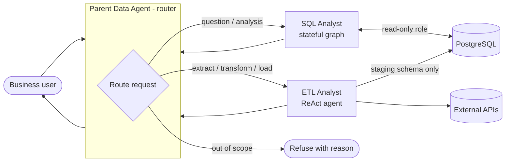
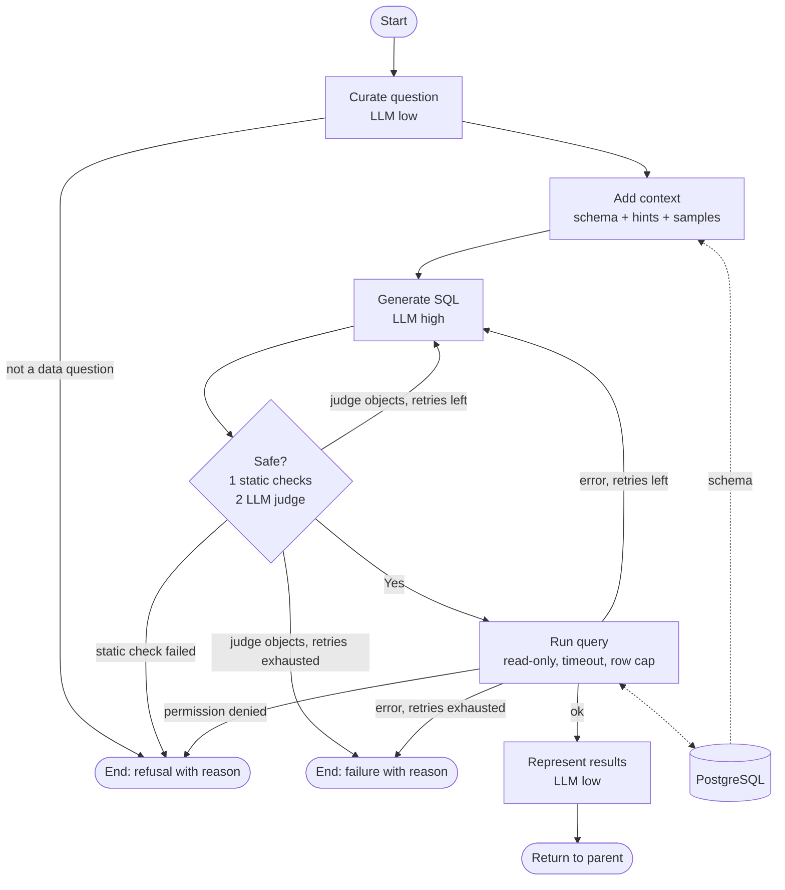

# DataPilot: Design Document

An agentic AI system that takes natural-language requests from business users and automates routine data work: answering questions with SQL and running small ETL jobs. It works against **any PostgreSQL database**. An Ola-style ride-booking dataset is the bundled demo.

Status: in progress. Phase 1 (foundation) is done; Phase 2 (SQL Analyst) is built and tested with a scripted LLM, with live-model verification pending API keys. See Appendix B.

---

## 0. Background

Business stakeholders (ops, product, finance) constantly need answers from the database: "which city had the most cancellations last week?", "load this partner's weather data so we can compare". Today they message a data analyst and wait, often a day, because the work queue is full of repetitive SQL and small ETL tasks. Analysts lose time on low-value requests, and stakeholders lose time waiting and cannot iterate on a question.

DataPilot handles that routine tier automatically and safely, and refuses or escalates anything it cannot do with confidence.

---

## 1. Goals and non-goals

**Goals**
- Answer analytical questions in plain English by generating, validating and running SQL.
- Perform simple ETL (fetch from an API, transform, load into staging tables) from plain-English requests.
- Be domain-agnostic: schema is discovered at runtime, domain knowledge is optional config.
- Be safe by default: the agent cannot modify or exfiltrate data through the query path.

**Non-goals (v1)**
- Non-Postgres engines.
- Multi-tenant auth, user management, or a hosted service.
- Fully autonomous writes to production tables.
- Very large schemas (hundreds of tables) beyond a basic table-selection step.

**Success metrics** (measured on the 20-question demo eval, see section 14)
- Correct result set on at least 85% of questions (compared by result set, not SQL text).
- 0 successful writes, DDL, or sensitive-column reads through the SQL path in the adversarial test corpus.
- p50 end-to-end latency under 10 s for a SQL question; p95 under 30 s.
- Cost per question stays within the free tiers of Groq and Gemini for the eval run; token cost is logged so a paid-tier cost can be computed.
- Retry loop recovers at least half of first-attempt SQL errors.

---

## 2. System architecture

A **parent/child agent** design built on LangGraph. The parent is a thin router. The children use the agent pattern that suits their job: a stateful graph for SQL, and a ReAct tool-calling loop for ETL.



| Component | Pattern | Why |
|---|---|---|
| Parent Data Agent | Single structured-output LLM call (Pydantic `Route`) | Routing is a classification, not a reasoning loop. Cheap and testable. |
| SQL Analyst | LangGraph `StateGraph` | Fixed, auditable steps with branching and retries; state is the point. |
| ETL Analyst | ReAct (`langchain.agents.create_agent`) | Tool choice is open-ended and needs no complex state. |

---

## 3. SQL Analyst (stateful graph)

Based on the project architecture diagram, with two additions: a **retry loop on execution error** and a **deterministic safety layer** in front of the LLM judge.



### Nodes

| Node | Model tier | Responsibility |
|---|---|---|
| `curate_question` | low | Normalise the request: resolve pronouns and follow-ups using chat history, strip noise, reject non-questions. |
| `add_context` | none | Read the schema as the read-only role sees it (`information_schema` for columns, `pg_catalog` for keys): tables, columns, types, PK/FK, and the distinct values of low-cardinality text columns. If the rendered schema exceeds `MAX_CONTEXT_CHARS`, keep the tables that best match the question (keyword overlap) plus their FK neighbours. Merge optional domain hints. |
| `generate_sql` | high | Produce one SQL query as structured output (`SqlDraft`: `sql`, `assumptions`). On retry, receives the previous SQL and the database error. |
| `safety_check` | none + low | Layer 1: deterministic; a failure ends the run with a refusal. Layer 2: LLM judge for intent; an objection is a wrong query, not a malicious one, so it goes back to `generate_sql` with the reason (same retry cap). The judge can be turned off with `JUDGE_ENABLED=false`. |
| `run_query` | none | Execute with the read-only role, `statement_timeout`, and a row limit. A Postgres permission error ends the run as a refusal; other database errors go back to `generate_sql`. |
| `represent` | low | Turn rows into a 1-3 sentence answer. The CLI renders the result table and, on request, the SQL. If this call fails, a plain "the query returned N rows" answer is used so a successful query is never lost. |

### Safety layers

1. **Static check (`sqlglot`)**: parse with the Postgres dialect. Require exactly one statement and a `SELECT` (CTEs and set operations allowed). Walk the whole parse tree and reject DDL/DML, `COPY`, `SET`, transactions, `GRANT`, `SELECT INTO`, `FOR UPDATE`, and data-modifying CTEs (these hide inside a root that parses as a plain `SELECT`). Reject a deny-list of functions (`pg_read_file`, `pg_sleep`, `set_config`, `current_setting`, `dblink*`, `lo_*`, advisory locks, and similar). Allow only the `public` and `staging` schemas, which also blocks `pg_catalog`, `information_schema` and cross-database references. Refuse early any query naming a hidden column (matched by column name, so it can over-block a same-named column elsewhere). If the query has no `LIMIT`, inject one (see "Row limit" below).
2. **Database enforcement**: connect as a role that has only `SELECT` on allowed tables and columns. Role-level defaults (`default_transaction_read_only = on`, `statement_timeout`) add friction but are not hard limits, because a session can change them; the missing privileges are the hard limit, and layer 1 blocks `SET` statements. `run_query` also applies `STATEMENT_TIMEOUT_MS` per session. **Sensitive columns are enforced here too**: the read-only role gets column-level `GRANT SELECT (col, ...)` that omits hidden columns (or reads through views that exclude them). A query touching `customers.phone` fails in Postgres regardless of what the LLM or the parser thinks. This is the real security boundary; layer 1 is defense in depth.
3. **LLM judge**: checks only that the SQL answers the curated question. It catches wrong queries, not malicious ones, and is never relied on for security.

**Row limit:** `run_query` is authoritative. It fetches at most `MAX_ROWS` rows (default 1000) with `fetchmany` and reports truncation to the user. The injected `LIMIT` in layer 1 is `MAX_ROWS + 1`, so `run_query` can tell "exactly the cap" from "more than the cap" and set the truncation flag; it also saves the database work.

### State

```python
class SqlState(BaseModel):
    user_question: str
    history: list[dict[str, str]] = []     # prior turns, for follow-up questions
    curated_question: str | None = None
    schema_context: str | None = None
    sql: str | None = None
    assumptions: list[str] = []
    safety: SafetyVerdict | None = None    # ok: bool, reason: str
    columns: list[str] = []
    rows: list[dict] | None = None
    truncated: bool = False
    feedback: str | None = None            # judge objection or DB error fed back to generate_sql
    attempts: int = 0                      # SQL generations; capped at 1 + MAX_SQL_RETRIES
    llm_calls: int = 0
    tokens_in: int = 0
    tokens_out: int = 0
    answer: str | None = None
    status: Literal["ok", "refused", "failed"] | None = None
    reason: str = ""
```

---

## 4. ETL Analyst (ReAct)

A tool-calling agent that decides which tools to run, in what order, from a plain-English request such as "pull daily weather for each city we operate in and load it".

**Tools**

| Tool | Purpose |
|---|---|
| `fetch_api(url, params)` | HTTP GET with an allow-listed host set, timeout, and response size cap. Returns a handle to the raw data. |
| `inspect_data(handle)` | Preview columns, types, and sample rows. |
| `transform(handle, spec)` | Declarative pandas transforms (rename, cast, filter, join, aggregate), not arbitrary code execution. |
| `load_staging(handle, table)` | Write to the `staging` schema only. Creates or replaces the table. |
| `list_tables()` | Show the tables the ETL role can see: `staging` plus any explicitly granted reference tables. |

**Guardrails**
- Writes only through the ETL role, which has `CREATE`/`INSERT` on `staging` and no write access to source tables.
- **No exfiltration path.** The ETL role does **not** get `SELECT` on source tables; it can read only `staging` and reference tables explicitly granted. The grant mechanism does not exist yet (the init script gives the ETL role no access to `public`); Phase 4 must add it, for example an `ETL_READABLE_TABLES` setting applied by `apply-grants`, so the ETL agent can read the list of cities without seeing customer data. `fetch_api` parameters and URLs are built from the user's request and validated by code: they may not contain values taken from database reads, and hosts are allow-listed. Data from external APIs flows into the database, never the other way out.
- **Idempotent, atomic loads.** `load_staging` writes to a temporary table inside a transaction, then swaps it in with an atomic rename (`BEGIN; ... ALTER TABLE ... RENAME; COMMIT`). A failure midway rolls back and leaves the previous table untouched. Re-running the same request produces the same table, not duplicates. Each load records a row in `staging._loads` (table, source, row count, timestamp, status).
- No arbitrary code execution: transforms are a typed spec interpreted by our code.
- Max tool-call steps per request.
- Promotion from staging to production tables is a manual step in v1.

---

## 5. Parent Data Agent

One structured-output call returning:

```python
class Route(BaseModel):
    target: Literal["sql_analyst", "etl_analyst", "refuse"]
    reason: str
    request: str  # cleaned request forwarded to the child
```

The parent holds the conversation history, passes the relevant slice to the child, and formats the child's result for the user. Out-of-scope requests (for example "delete all rides") are refused with a reason.

---

## 6. Worked example

Request: *"Which city had the most cancellations last week?"*

1. **Parent** gets the message and returns `Route(target="sql_analyst", reason="analytical question", request=...)`.
2. **curate_question** (low): "Which city had the most cancelled bookings in the previous calendar week?"
3. **add_context**: reads the schema, selects `bookings` and `cities`, adds sample values (`status` in `completed`, `cancelled`, `no_show`) and hints ("`cancel_reason` set only when status = 'cancelled'").
4. **generate_sql** (high):
   ```sql
   SELECT c.name, COUNT(*) AS cancellations
   FROM bookings b JOIN cities c ON c.id = b.city_id
   WHERE b.status = 'cancelled'
     AND b.created_at >= date_trunc('week', now()) - interval '1 week'
     AND b.created_at <  date_trunc('week', now())
   GROUP BY c.name ORDER BY cancellations DESC LIMIT 1;
   ```
5. **safety_check**: one `SELECT`, no denied functions, no hidden columns; judge confirms it answers the question. Verdict: safe.
6. **run_query**: executes as the read-only role in 40 ms and returns `[("Bengaluru", 1342)]` (illustrative values).
7. **represent** (low): "Bengaluru had the most cancellations last week, with 1,342." Shows the SQL and the stated assumption (week means the previous Monday-to-Sunday).
8. **Trace** in Langfuse (and the JSONL log) records the route, curated question, SQL, verdict, attempts (1), latency, and token usage.

If step 6 had failed with `column "created_at" does not exist`, the error goes back to `generate_sql` for attempt 2. If step 5 had failed the static check (for example a `DROP`), the run ends with a refusal and the reason, and nothing executes. If only the judge had objected, the objection goes back to `generate_sql` the same way.

---

## 7. Genericity: making it work on any database

| Concern | Approach |
|---|---|
| Schema | Discovered at runtime from `information_schema` and `pg_catalog`. Nothing hard-coded. |
| Domain knowledge | Optional `hints.yaml`: table/column descriptions, business definitions, units, sensitive columns. |
| Large schemas | Table selection when the schema exceeds `MAX_CONTEXT_CHARS`: keyword overlap between the question and table, column and hint text, plus FK neighbours. Embedding or LLM ranking is a possible upgrade. |
| Connection | `DATABASE_URL` (read-only role), `ETL_DATABASE_URL` (ETL role), `ADMIN_DATABASE_URL` (setup only: demo load and grants). |
| Demo data | `datapilot demo load` generates the synthetic Ola-style dataset. The demo is the only place that knows about rides. |

Example `hints.yaml`:

```yaml
tables:
  bookings:
    description: One row per ride request.
    columns:
      fare_amount: Final fare in INR, null if cancelled.
      cancel_reason: Set only when status = 'cancelled'.
hidden_columns:          # enforced via column-level grants; also removed from schema context
  - customers.phone
  - customers.email
```

`datapilot db apply-grants` reads `hidden_columns` and generates the matching `GRANT`s for the read-only role, so the config and the database cannot drift silently.

---

## 8. Models

The project is **provider-agnostic**. Each tier is configured as `provider:model` through environment variables and built by one factory (`config.get_llm(tier)`), so no node knows which vendor it is talking to. Supported providers today: Groq (`langchain-groq`) and Google Gemini (`langchain-google-genai`). Adding another LangChain chat model is one new branch in `get_llm`.

| Tier | Default | Used for |
|---|---|---|
| low | Groq `llama-3.1-8b-instant` | Curate, represent, route, simple judging. Fast and cheap. |
| high | Gemini Flash (or Groq `llama-3.3-70b-versatile`) | SQL generation, retry repair. |

Model names change often; verify them against each provider's current docs when implementing.

Constraints of free tiers that the design must handle:
- **Rate limits:** retries with exponential backoff on 429s, and a global cap on LLM calls per request.
- **Structured output:** nodes use Pydantic structured output with a JSON-parse fallback and one repair attempt, since smaller models are less reliable at it.
- **Smaller context windows:** schema context is capped and table selection is applied earlier.
- **Weaker SQL generation:** the retry loop, sample values in context and the static safety layer matter more than they would on a frontier model.

```env
LLM_LOW=groq:llama-3.1-8b-instant
LLM_HIGH=google:gemini-flash-latest
GROQ_API_KEY=...
GOOGLE_API_KEY=...
```

---

## 9. Tech stack

| Layer | Technology | Role |
|---|---|---|
| Agent orchestration | **LangGraph** | `StateGraph` for the SQL Analyst and the parent graph. |
| LLM abstraction | **LangChain** (`langchain-core`; `langchain` is added in Phase 4 for `create_agent`, the ReAct agent factory that replaces the deprecated `langgraph.prebuilt.create_react_agent`) | Chat model interface, structured output, tool definitions, the ETL ReAct agent. |
| LLM providers | `langchain-groq`, `langchain-google-genai` | Groq and Gemini free tiers; swappable via config. |
| Data models | **Pydantic v2** | Graph state, `Route`, `SqlDraft`, `SafetyVerdict`, settings (`pydantic-settings`). |
| Database | **PostgreSQL 16** (Docker) | Demo and target database. |
| DB driver | `psycopg` 3 | Connections for the read-only and ETL roles. |
| SQL parsing | `sqlglot` | Static safety checks (Postgres dialect). |
| Data handling | `pandas`, `httpx` | ETL transforms and HTTP fetches. |
| CLI | `typer`, `rich` | Interface and output formatting. |
| Observability | **Langfuse** (self-hosted, Docker) plus a stdlib JSONL log | LLM traces, token cost, eval runs; JSONL keeps tests and evals working offline. |
| Tooling | `uv`, Python 3.12, `pytest`, `ruff` | Environment, tests, lint. |
| Packaging | Docker Compose | Postgres plus init scripts. |

Versions are locked in `uv.lock`. LangChain, LangGraph and Langfuse change quickly, so the lock matters.

---

## 10. Interfaces and configuration

**CLI** (`datapilot`)

| Command | Purpose |
|---|---|
| `datapilot chat` (planned, Phase 5) | Interactive session with the parent agent. Shows the answer, then the SQL and trace id on request. |
| `datapilot ask "<question>"` | One-shot question to the SQL Analyst; prints the answer and result table. Add `--show-sql` or `--json`. Exits non-zero on refusal or failure. |
| `datapilot demo load` | Create the demo schema and generate synthetic data. |
| `datapilot db apply-grants` | Generate and apply role grants from `hints.yaml`. |
| `datapilot db schema` | Print the schema context exactly as the agent sees it. |
| `datapilot eval` (planned, Phase 3) | Run the eval set and print accuracy, latency, and token use. |
| `datapilot trace <id>` (planned) | Print one request from the JSONL log, with a link to its Langfuse trace. |

**Environment variables** (loaded from `.env`, never committed)

| Variable | Default | Meaning |
|---|---|---|
| `ADMIN_DATABASE_URL` | required | Admin connection for `demo load` and `apply-grants` only; never used by the agents. |
| `DATABASE_URL` | required | Read-only role connection. No default, so a missing value fails fast. |
| `ETL_DATABASE_URL` | required | ETL role connection. |
| `LLM_LOW`, `LLM_HIGH` | see Models | `provider:model` per tier. |
| `GROQ_API_KEY`, `GOOGLE_API_KEY` | none | Provider keys. |
| `MAX_SQL_RETRIES` | 2 | Retry cap in the SQL Analyst. |
| `MAX_ROWS` | 1000 | Authoritative row cap. |
| `STATEMENT_TIMEOUT_MS` | 10000 | Per-session query timeout applied by `run_query`. |
| `MAX_CONTEXT_CHARS` | 12000 | Schema context cap before table selection kicks in. |
| `JUDGE_ENABLED` | true | Turn the LLM judge off if it over-rejects on small models. |
| `MAX_LLM_CALLS_PER_REQUEST` | 12 | Hard cap, protects free-tier quotas. |
| `ETL_ALLOWED_HOSTS` | empty (deny all) | Comma-separated allow-list for `fetch_api`. |
| `HINTS_PATH` | empty (no hints) | Optional domain hints file. The Ola demo hints are bundled at `src/datapilot/demo/hints.yaml`. A set but missing path is an error. |
| `LANGFUSE_HOST` | `http://localhost:3001` | Self-hosted Langfuse URL. Tracing is skipped if unset. |
| `LANGFUSE_PUBLIC_KEY`, `LANGFUSE_SECRET_KEY` | none | Project keys created in the Langfuse UI. |

**Error handling contract.** Every request ends in one of three statuses, returned to the user with a plain-language reason: `ok`, `refused` (unsafe, out of scope, or hidden data), or `failed` (retries exhausted, provider outage, timeout). The agent never returns an answer from a query that did not run successfully.

---

## 11. Demo dataset

Synthetic ride-booking data (about 50k bookings over 90 days) generated with a fixed random seed so results are reproducible.

| Table | Key columns |
|---|---|
| `cities` | `id`, `name`, `state` |
| `customers` | `id`, `name`, `phone`, `email`, `city_id` (phone and email are hidden columns) |
| `drivers` | `id`, `name`, `rating`, `city_id`, `vehicle_type` |
| `bookings` | `id`, `customer_id`, `driver_id`, `city_id`, `vehicle_type`, `status` (`completed`, `cancelled`, `no_show`), `cancel_reason`, `distance_km`, `fare_amount` (INR), `created_at` |
| `payments` | `id`, `booking_id`, `method`, `amount`, `paid_at` |

The generator injects known patterns (for example, higher cancellations in one city on weekends) so eval questions have verifiable answers.

---

## 12. Alternatives considered

| Decision | Rejected alternative | Why |
|---|---|---|
| Parent router plus two specialised agents | One ReAct agent with every tool | SQL needs a fixed, auditable pipeline with a safety gate that cannot be skipped. A free-roaming agent could skip it. A small model also picks tools more reliably from 3 options than from 12. |
| LangGraph for the SQL Analyst | Plain Python functions | Plain functions would work for a linear flow, but the branches, retry loop and typed state are exactly what LangGraph models and traces. We accept the dependency cost. The nodes stay pure functions, so they remain testable without it. |
| `sqlglot` static check **and** a restricted DB role | Only the DB role | The role is the real boundary, but static checks give a clear refusal reason before execution, block expensive or odd constructs early, and fail fast. |
| Restricted DB role | Only `sqlglot` or the LLM judge | Parsers have gaps and LLM judges can be bypassed. Only the database can enforce permissions reliably. |
| LLM judge for intent | No judge | Static checks cannot tell whether a safe query answers the right question. The judge is cheap and catches wrong joins and filters. |
| Typed transform spec for ETL | Let the LLM write and run pandas code | Arbitrary code execution is a large attack surface, and prompt injection from API data would reach it. |
| Staging schema plus manual promotion | ETL writes directly to production tables | A wrong autonomous write to production is hard to undo. |
| Schema read at runtime | Fine-tuned or hard-coded schema prompts | Hard-coding would tie the project to one dataset and go stale. |

---

## 13. Observability

Agentic systems fail in ways that are only visible in a trace, so every request produces a structured trace:

- request id, user input, route decision;
- per node: input summary, output, latency, model used, token counts;
- generated SQL, safety verdicts with reasons, retry count and the DB errors that caused them;
- final answer and status (`ok`, `refused`, `failed`).

**Langfuse (primary).** A self-hosted Langfuse instance runs in Docker Compose next to Postgres. The Langfuse LangChain callback handler is attached to every graph invocation, so each node's prompt, response, latency, token count and cost appear as one trace with nested spans. The request id is passed as trace metadata; richer tags and scores (route, safety verdict, attempt number) and Langfuse datasets for eval runs are planned. **Status:** the handler is wired in but untested, and the installed Python SDK (v5) may not be compatible with the self-hosted v2 server in `docker-compose.yml`; this must be resolved (pin the SDK or move to Langfuse v3) before relying on it.

**JSONL log (offline fallback).** Each request also appends one line to `logs/traces.jsonl` with request id, route, curated question, final SQL, safety verdicts, attempts, status and token totals. The planned eval runner will read this file, so evals work without Langfuse running. If Langfuse is not configured or its setup fails, the agent logs a warning and continues; observability must never break a request.

**Privacy.** Traces contain prompts and query results, so they may include business data. Langfuse is self-hosted, so nothing leaves the machine except the LLM calls themselves. Values of hidden columns never appear in traces because they never reach the prompt or the result set. A refused query or the user's own question may still name a hidden column.

The callback interface is generic, so LangSmith could replace Langfuse by swapping the handler.

---

## 14. Testing strategy

- **Unit (no LLM):** static safety checks against a corpus of malicious and benign SQL; hint merging; config rules; context trimming; LLM-layer repair and backoff; routing logic (Phase 5).
- **Security tests (real Postgres roles, no LLM):** the read-only role cannot write, run DDL or read hidden columns; the ETL role cannot touch source tables; timeouts are enforced.
- **Graph tests (scripted LLM, real database):** every path (safe, unsafe, retry then success, retry exhausted, judge objection, permission error, call budget, truncation, summary failure).
- **Live evals (opt-in):** ~20 question/expected-result pairs on the demo dataset, comparing result sets rather than SQL text.

---

## 15. Risks and open questions

| Risk / question | Mitigation or default |
|---|---|
| Free-tier rate limits and weaker models | Backoff, call caps, structured-output repair, tiering across two providers. |
| LLM writes a plausible but wrong query | Judge node, sample values in context, show SQL and assumptions in the answer. |
| Prompt injection via data values or API responses | Treat all data as untrusted; DB role limits damage; ETL has no code execution. |
| Cost on large schemas | Table selection; cap context size. |
| Which API for the ETL demo? | Default: Open-Meteo (free, no key), joined to rides by city and date. |
| CLI vs web UI | CLI first; Streamlit later if wanted. |
| Langfuse SDK v5 vs self-hosted server v2 | Untested; pin the SDK or move to Langfuse v3 when tracing is first exercised. |
| ETL role cannot read the city list it needs | Add an explicit reference-table grant in Phase 4. |

---

## Appendix A. Project layout (implementation plan)

```
datapilot/
  docs/DESIGN.md
  docker-compose.yml          # Postgres 16; Langfuse v2 + its own DB under --profile observability
  db/init/                    # roles, staging schema, load log
  pyproject.toml, uv.lock
  .env.example
  logs/                       # traces.jsonl (gitignored)
  src/datapilot/
    config.py                 # settings, get_llm(tier)
    hints.py                  # hints.yaml loading
    db.py                     # connections, introspection, grants, hints check
    llm.py                    # structured output, repair, backoff
    tracing.py                # JSONL log, optional Langfuse
    cli.py
    demo/{generate.py,hints.yaml}
    sql_analyst/{state,context,nodes,graph,safety}.py
    etl_analyst/{tools,agent}.py      # Phase 4
    parent/{router,graph}.py          # Phase 5
  tests/
```

---

## Appendix B. Build phases

1. **Foundation (done):** scaffold, Postgres in Docker, roles, synthetic data, introspection.
2. **SQL Analyst (built; live-model verification pending API keys):** safety layers, nodes, graph, retries, `ask` command, tracing, tests with a scripted LLM.
3. **Eval harness:** the 20-question eval set and runner, so prompt and model choices are measured.
4. **ETL Analyst:** tools, ReAct agent, staging-only writes.
5. **Parent router:** routing, conversation loop.
6. **Polish and portability:**
   - `datapilot db setup`: create the roles, `staging` schema and grants on any existing database from an admin URL, with role and database names as parameters, and verify that the read-only role cannot write.
   - Startup guard: refuse to run the SQL agent if its role can write or is a superuser.
   - Guard on `demo load` so it cannot drop tables in a non-demo database.
   - Multi-schema support (introspection is limited to `public` today), README, adversarial tests.
